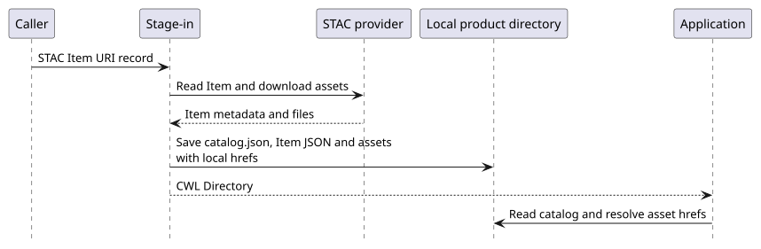
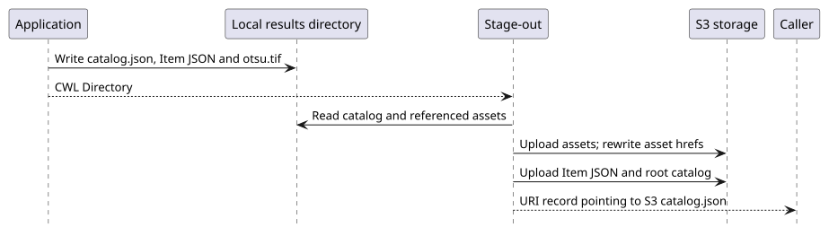
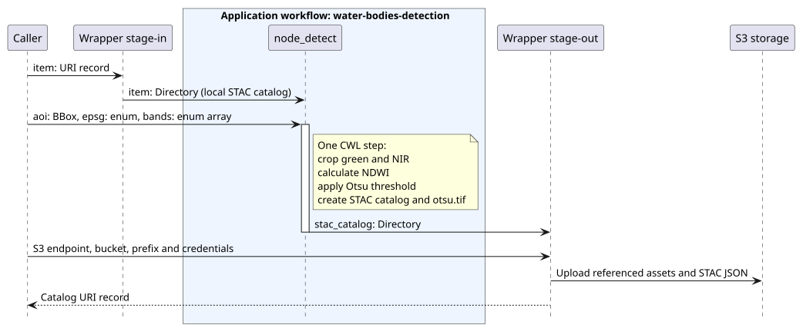

# Platform data flow management

The platform translates an EO product reference into the application's local STAC manifest, then persists the results. See [OGC Best Practice 20-089r1, section 9.4](https://docs.ogc.org/bp/20-089r1.html).

## Stage-in

The example downloads a referenced STAC Item and its assets, rewrites local paths, and saves a self contained catalog. The general platform model can also support remotely accessible assets; the training tool downloads them.

[PlantUML source](assets/diagrams/stage-in.puml)

## Stage-out

The application creates a local catalog describing its output. The example uploads referenced assets and Item JSON, rewrites their locations to S3, and uploads the root catalog last. It does not register results in a separate searchable catalog service or implement an OGC API Processes endpoint.

[PlantUML source](assets/diagrams/stage-out.puml)

## Water body detection example

This diagram matches `app-water-bodies.cwl`: the application workflow has one `node_detect` step. Cropping, NDWI calculation, Otsu thresholding, and STAC creation happen inside that step. There is no CWL scatter in this implementation.

[PlantUML source](assets/diagrams/water-bodies.puml)

See [typed interfaces and execution commands](cwl-reference.md). To edit or regenerate diagrams, follow [documentation maintenance](validation.md#diagrams).
